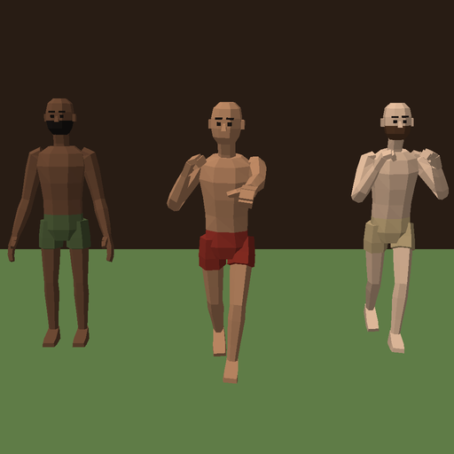

# Example Mod: Dude Bro

This mod reskins and renames one unit. Levy Swordsmen (Iron Legion) become Dude Bros, bare-knuckle brawlers. They
keep their stats, their orders and how they fight. Only their look and their name change:

- in battle (model and animations),
- on the recruit screen, the prestige screen and in the Collection,
- on every unit card (the new `icon.png`),
- everywhere the unit's name shows, in every language (`localization_overrides.json`).

Each squad mixes three looks: a brown beard with linen shorts, clean-shaven with red shorts, and a black beard with
green shorts. In melee they throw a jab and a cross, and now and then a front kick.

Use this folder as a working example to copy. The rest of this file explains how a reskin works and how to make
your own.



**The model** was made for this example. A Python script in `source/` builds the body, the skeleton and the
animations in code, with no model file. Everything in this mod is CC0: copy it and change it however you like.

---

## 1. Try it

1. Copy this folder into the game's Mods folder, so it sits here:
   `%USERPROFILE%\AppData\LocalLow\MemoriStudios\TabletopTavern\Mods\ExampleUnitMod\`
2. Start the game (restart it if it is already running). New mods switch on by themselves the first time the game
   finds them.
3. Open **Mods** from the main menu and check that "Example Mod - Dude Bro" is listed and enabled.
4. Look for Dude Bros: start an Iron Legion run and open the recruit screen, look them up in the Collection, or put
   them in a custom battle.

To switch it off, untick it in the **Mods** menu and restart. To remove it, delete the folder.

---

## 2. What is in this folder

```text
ExampleUnitMod/
    mod.json                        the mod's name, author and description (required)
    localization_overrides.json     the unit's new name, in every language
    preview.png                     the Steam Workshop picture
    README.md                       this file
    unit_visuals/
        LevySwordsmen/              one folder per unit you reskin, named exactly like the unit
            unit.json               the list of everything below: bones, animations, materials, variants
            anim.bin                the animation: every bone's position on every frame
            body.mesh.bin           the body, bent by the animation
            palette_brown_beard.png one colour palette per variant (look)
            palette_clean_shaven.png
            palette_black_beard.png
            icon.png                the unit card picture, 512 x 768
    source/
        make_dude_bro.py            the script that builds everything in unit_visuals (optional)
        check_unit_visual.py        a checker you can run on your own unit folder
```

The game reads `mod.json`, `localization_overrides.json` and the `unit_visuals` folder. The `source` folder is ignored
by the game. You can delete it, or keep it so others can learn from it.

The unit folder keeps the name `LevySwordsmen`: that is how the game knows which unit to reskin. The name players see
is set separately, in `localization_overrides.json`.

All three variants share one body mesh. Each variant uses its own material, and each material paints the body from a
different palette. That is the cheapest way to make variants: one model, several textures.

This model has no props, so there is no `anchors.bin`. A unit that holds a sword or a shield has one: it records
where each hand is on every frame so the prop can follow it.

---

## 3. The quickest changes: repaint and rename

### Repaint the palettes

You can change the colours without any 3D tools. Each palette is a 256 x 256 PNG split into four squares:

| Square | Paints |
| --- | --- |
| top left | skin |
| top right | eyes |
| bottom left | beard (paint it the skin colour for no beard) |
| bottom right | shorts |

Open a palette in any paint program, fill a square with a new colour, and save it with the same name and size.
Restart the game to see it. Blue skin and gold shorts, for example, and you have a different army.

### Rename the unit

The unit's name comes from a text key named after the unit, here `LevySwordsmen`. `localization_overrides.json` gives
that key new text, one entry per language:

```json
{ "locale": "en", "key": "LevySwordsmen", "text": "Dude Bro" }
```

Change the text and restart the game. A language you leave out keeps the game's own name for the unit. The codes are
`en`, `de`, `es`, `fr`, `ja`, `ko`, `ru`, `zh` and `zh-Hant`.

---

## 4. Make your own reskin

A unit model is normally built in **Unity** with **TJBake**, a free tool that turns an animated character into the
files above. This example took a shortcut: the script in `source/` builds a simple low-poly body and its animations
in code and writes the files directly. Most people will find Unity easier.

### What you need

- **Unity 6 or later** with the **Universal Render Pipeline** (URP). The free Personal licence is fine.
- **TJBake.** In Unity, open `Window > Package Manager`, press `+`, choose **Install package from git URL** and
  enter `https://github.com/Memori-Studios/TJBake.git`
- **A rigged, animated character.** Any character with a skeleton works, people or creatures. Free sources include
  Sketchfab (filter by downloadable and licence), Mixamo, and the CC0 packs from Quaternius and Kenney. Read the
  licence, and give credit when it asks for it, as this mod does.

### Step 1: Pick the unit

Choose which unit to replace. The folder name must be the unit's internal name, with exact spelling and case:
`LevySwordsmen`, `HelmwallDefenders`, `PeasantBowmen`. The modding guide lists every name in its "Unit name
reference" and in `unit_stats.csv`. That file also shows the unit's type (Melee, Ranged and so on), which decides
how many animations you need.

Artillery and the garrison gate cannot be reskinned yet.

### Step 2: Prepare the character

- **Size and direction.** Build it in metres, standing with its feet at height 0 and facing forward (Unity's +Z, the
  blue arrow). A person is about 1.8 m tall, like this one. Keep it narrower than about 1.5 m at the feet or it
  overlaps its neighbours in formation.
- **In place.** The animations must not walk away from the origin. Turn off root motion. The game moves the unit;
  the model only animates on the spot.
- **One prefab.** Make a prefab that holds the character's `SkinnedMeshRenderer` and an `Animator`. Give the
  Animator a controller that contains every animation clip you want to use.

### Step 3: Get the animations

The game asks for animations by slot number, not by name. A melee unit needs slots 0 to 12. A unit that shoots or
casts (Ranged, Hybrid, Mage) needs slots 0 to 14.

| Slot | What it is | How it plays | This mod |
| --- | --- | --- | --- |
| 0 | idle | loops | breathes, arms hanging |
| 1 | walk | loops | walks |
| 2 | run | loops | runs, leaning forward |
| 3 | melee stance | loops | fists up, bouncing on his knees |
| 4 | melee attack | once, then back to idle | a left jab, then a right cross |
| 5 | idle extra 1 | once, then back to idle | looks left and right |
| 6 | idle extra 2 | once, then back to idle | stretches both arms overhead |
| 7 | idle extra 3 | once, then back to idle | waves |
| 8 | death 1 | once, then holds the last frame | falls on his back |
| 9 | death 2 | once, then holds the last frame | falls on his face |
| 10 | death 3 | once, then holds the last frame | crumples onto his side |
| 11 | thrown | once, then back to idle | back-flips and lands in a crouch |
| 12 | melee attack 2 | once, then back to idle | front kick (used for 1 in 10 attacks) |
| 13 | ranged stance | loops | only for units that shoot or cast |
| 14 | ranged attack | once, then back to idle | only for units that shoot or cast |

Tips:

- You can use the same clip in more than one slot. Three identical deaths are fine.
- Deaths must end lying on the ground. The body stays there until the battle ends.
- Loops should end where they start, or the unit jumps once per loop.
- The game times the damage itself. The attack animation only has to look right.

### Step 4: Bake with TJBake

1. Select your character prefab in the Project window.
2. Open `Window > TJBake` and press **New profile from the selected prefab**. TJBake guesses a clip for each slot from
   the clip names.
3. Go through every slot. Pick the clip and check how it plays (loops, plays once and returns to idle, or plays once
   and holds). A clip that returns to idle hands back at `returnAt`, a fraction of the clip (0.9 by default).
4. Add **anchors** for everything the character holds or wears: `Add anchor at bone` on the hand or head bone.
5. Add **attachments**: the prop prefab, the anchor it follows and its **role**:
   - `prop` for anything that only looks nice (hats, capes, swords on melee units).
   - `shield` for a shield. Arrows that hit the squad stick in it.
   - `bow` and `sword` for ranged units that put the bow away in melee (see the rules below).
   - `saddle` for mounted units: the rider sits here.
6. Set the output folder to your mod: `Mods/<YourMod>/unit_visuals/<UnitName>`.
7. Press **Check**, then **Bake**, then **Preview** to watch it play in the Scene view.

Optional extras:

- **Variants.** Up to three versions of the model (different faces, helmets, colours, weapons). Squads mix them. This
  mod uses three variants that share the body and change only the palette.
- **LODs.** Simpler versions of the model for when the camera is far away.
- **A rider** for a mounted unit.

### Step 5: Add an icon

Put a 512 x 768 PNG named `icon.png` in the unit folder, the same size as the game's own unit pictures. It replaces
the unit's picture on every card. A transparent background looks best. Without it, the unit keeps its normal icon.
An older 256 x 256 icon still loads, but it shows smaller on the cards.

### Step 6: Add mod.json

Copy `mod.json` from this mod into your mod folder and change the name, author and description. Leave
`workshopFileId` empty; the game fills it in when you publish.

### Rebuilding this example from source

`source/make_dude_bro.py` needs Python 3.9 or newer with numpy and Pillow (`pip install numpy pillow`). From inside
`source/`, run:

```text
python make_dude_bro.py ../unit_visuals/LevySwordsmen --preview ../preview.png
```

The body is a list of rings and boxes in `make_body()`: change a radius to make the arms thicker, or a height to
make the shorts longer. Change the animations or the palette colours the same way, run the script again, and restart
the game to see them.

---

## 5. Rules the game checks

If any rule is broken, the game writes one error in its log and the unit keeps its normal look. Nothing crashes.

- **The folder name is the unit's name**, exact spelling and case. An unknown name is skipped.
- **Animations:** slots 0 to 12 for melee units, 0 to 14 for units that shoot or cast. Slot numbers start at 0 with
  no gaps. Every clip has at least 2 frames. All clips share one frame rate: 24, 30 or 60.
- **Bow and sword.** Most ranged units put their bow away and draw a sword in melee. If the unit you replace does
  that, every variant needs one `bow` prop and one `sword` prop. If it does not, no variant may have both. Melee
  units like Levy Swordsmen never have both. The game checks this rule when a battle loads.
- **Riders.** A mounted unit can bring its own rider or keep the game's rider. Either way every variant needs a
  `saddle` prop. A unit that has no rider in the game cannot get one.
- **One to three variants.** Each variant has the same number of LODs.
- **Textures** are PNG files inside the unit folder, at most 4096 pixels on a side.
- **Size limits:** a mesh file 64 MB, the animation 256 MB, the whole unit folder 512 MB.

---

## 6. Check your folder before you start the game

`source/check_unit_visual.py` runs the same checks as the game, outside the game. It needs Python 3.9 or newer and no
extra packages.

```text
python check_unit_visual.py "<path to>/unit_visuals/LevySwordsmen"
```

Add `--shoots` for a Ranged, Hybrid or Mage unit, and `--swaps-bow-for-sword` if the game's unit puts its bow away
in melee. It prints `OK` or the first problem it finds.

## 7. If it does not show up

1. Check the **Mods** menu: is the mod listed and enabled? Did you restart the game after changing files?
2. Open the game's log:
   `%USERPROFILE%\AppData\LocalLow\MemoriStudios\TabletopTavern\Player.log`
3. Search it for `Unit visuals` and `UnitVisualOverride`.
   - `Unit visuals (...): 1 unit visual(s) registered.` means the game found your folder at start-up.
   - `built 3 mod variant(s) from ...` means a battle loaded it.
   - Any error on those lines names the file and the rule that failed, and ends with "The built-in visual stays" or
     "The built-in visual loads instead".

Common mistakes: the folder name has a typo or a space, the model faces the wrong way, the model is 100 times too
big (centimetres instead of metres), or animations still have root motion.

## 8. Share it on the Steam Workshop

1. Put a `preview.png` in your mod folder. Steam shows it on the Workshop page.
2. Open **Mods** from the main menu and press **Publish** on your mod's row, then press it again to confirm.
3. To update it later, press **Publish** again. The game updates the same Workshop item.

Only share models, textures and animations you have the right to share, and keep the credit lines their licences
ask for.

---

## Credits and licences

- **Everything in this mod** (the model, animations, palettes, icon, preview and the scripts in `source/`) was made for
  this example and is released under CC0. Copy it, change it and share it however you like.

More detail on the file format: the Tabletop Tavern modding guide, `docs/unit-json-schema.md` and
`docs/unit-visual-contract.md`.
